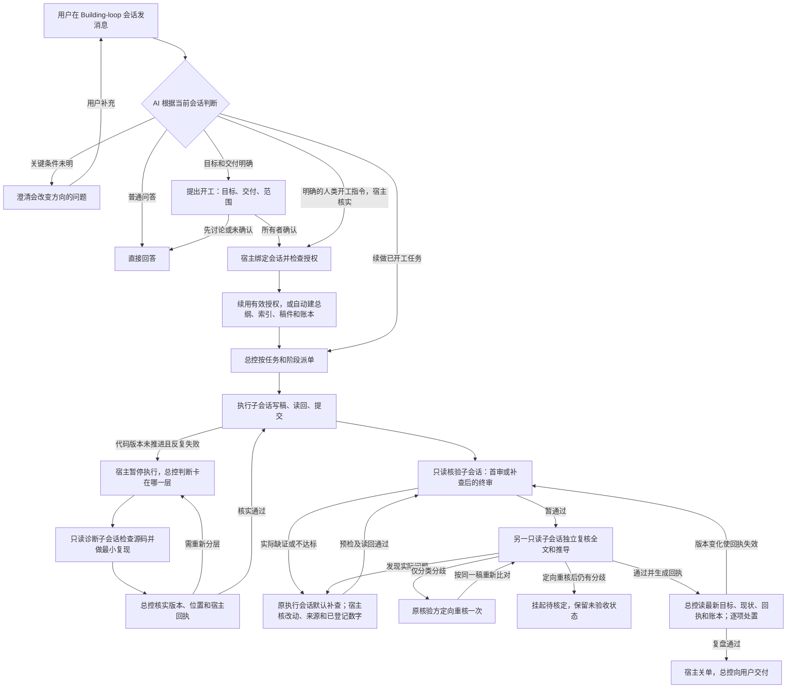

# Building-loop 当前流程

上级为[派单与交付索引](work-delivery.md)。本图按 0.7.26 的[会话开工](../governance/conversation-start.mjs)、[宿主阶段](../governance/index.mjs)和[账本动作](../governance/ledger.mjs)绘制。

上图是单个工作单元的循环。初稿过首审可直接进入独立复核；只有真实退回才需要补查。补查默认复用本单元的执行会话，也可以按配置换新会话。冷重启时，宿主先核实阶段、原会话身份和独占写租约，再用原会话与有效检查点续做。

| 谁 | 管什么 |
|---|---|
| 用户／维护者 | 确认是否开工；决定目标和范围。已有工程的多单元文件权限、来源登记、复算公式按项目授权配置。 |
| 总控 | 管总纲、派单、状态、回执和账本；只访问已授权的总控文件。 |
| 执行子会话 | 读本单元获准的目标和资料，写获准的交付稿；按真实退回项修订。 |
| 只读诊断子会话 | 在授权源码与隔离副本上定位重复故障。交付当前版本、源码行号和实测回执，修复交回原执行会话。 |
| 核验子会话 | 核全文、出处、推导、当前目标和交付质量；给出最小退回依据。 |
| 独立复核子会话 | 用另一个只读会话核同一版稿件；不接收上一审的结论或回执。它可能使用相同模型。 |
| DSH 宿主 | 在每步注入角色、阶段与当前目标，按文件白名单拦截工具，保存状态、回执、逐文件日志及一份改前备份；关单前检查账本与版本。 |

项目文件分三层：**一级总纲**写目标和现状 → **二级索引**定位分块和资料 → **三级正文**保存成果、原始证据与回执。账本横跨三个层级：用户任务、派单与中断有自动登记，后续计划也可以登记；每轮核对最新目标和已验收成果后再决定保留、续做、延期、完成、被覆盖或失效。受控写入的更新日志与滚动备份按文件保存。详见[项目文件与接手](project-files.md)和[资料核验与账本](../governance/verification.md)。

大白话：总控管方向，执行子会话干活，两个不同的核验会话查活，宿主看权限和交付手续，账本记着还有什么没办完。谁说“做完了”都得回到当前文件和回执核对。
