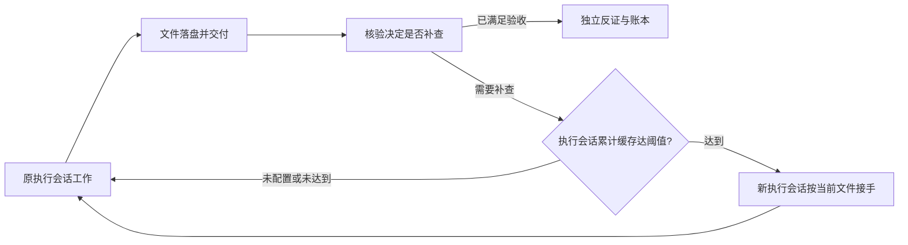

# 调用成本、共同误判与滚动交接

上级是[治理入口](README.md)与[派单分块](../docs/work-delivery.md)。全文与证明标准仍见[全文覆盖](full-coverage.md)，实测结果与失败记录见 [0.7.0 报告](../experiments/results-0.7.0.md)。

## 节省发生在哪里

`building_loop prepare` 返回本阶段授权的当前材料、确切行号、当前目标、覆盖入口和参数提示。只把实际返回的行登记为已读；有界分页未给出的部分仍是待读，不能用“已准备”代替完整读取。中断后同一会话、同一阶段且版本未变的已读记录可以保留；换角色、换阶段、改目标或改资料继续按当前版本核验。

可见工具按真实角色收窄，在 DSH 工具解析时安装限制，早于首次请求的 schema 快照。原生读写、搜索、终端及越权动作仍有工具层 guard。隐藏减少误调用，不是授权替代。独立探针也必须使用实际 SDK 解析后的工具集合，不能把未解析条件工具时的 unknown tool 当作产品故障；首次真实模型请求的工具广告另行核对。

全文 `status` 默认只返回计数、待核和退回摘要，详细证明留在宿主；需要追查时指定 `block` 取单块。`record` 一批里有效块保留，无效块明确列出并撤销失效的旧判断；没有清完 pending 就不能验收。来源变更后的旧证明变成待核，允许逐批重新验证，不因剩余旧块导致每批都回滚。

逐字片段不合时给出具体片段、块边界和实际原文窗口，避免模型只改理由却反复提交同一段错引。覆盖块必须由当前角色的准备或清单操作实际呈现，不能只看 pending 编号猜内容。两位核验有事实分类分歧时按具体争议处理，不能原样再送；同版本时各自保留自己未争议的证明，不共享另一核验者的证明。候选、目标、来源任一改变就撤销旧恢复材料，最后仍重新核全量当前引用。

子会话成功交付并通知总控后，宿主结束其当前轮，避免再付费生成 idle 复述。交付或通知失败不会被伪装成正常完成。反证最终提交只用 `audit`，其完整证明已经由逐块记录保存，不再重复发送整份 checks、quality 或正文。总控仍需完成账本与面向用户的回复。

这些改动保留第一核验、修订核验和独立反证的职责，保留数字复算、全覆盖、逐字证据、当前目标与来源版本约束。验收之后、账本关单之前再次核来源版本，资料变化不能借旧回执关单。

核验派单不消费总控自由 note，由宿主给中性的当前目标与阶段说明，避免把“前审已通过”或某个预判一并交给下一审查者。`unlisted` 与全文证明按具体事实范围对账，不能把已核非事实的标题再变成补查债。配置 `ledgerDocument` 后，可读账本直接由宿主完整导出当前条目与依据，不让模型二次转写出缺项、错误次数或虚构阶段史。

复杂推导建议每批记录 2—4 块，12 是上限，不是每次必须填满。明确编号的错例和常见 Markdown 前缀按等价标签处理；原句没有标签时不能推测它是错例。这个归一化减少格式返工，不放宽事实门槛。

补查的提前检查绑定新退回记录中的实际片段、原候选版本及当时所引范围的内容指纹。改正确前缀或来源别处不能冒充修复；原句保留而补证时，须在该句引用本轮已读的确切当前新材料。删除、更正、明确撤回或错例，以及范围类退回的实际限定，可以重新送给完整核验，不被机械判成仍未动。这里判断的是复审资格，最终含义和证据支持仍由两审判断。旧回执缺少片段时显式返回 `legacy-whole-line-only`，不会伪造历史精确凭据。

分类分歧重核通过宿主 `reason: classification-reconciliation`、数量和下一阶段解释，总控不需猜成系统路由故障。账本依据只说明本项处置和当前目标的关系，避免再次复述宿主计数与运行史；宿主完整导出并不保证模型登记的自然语言理由正确。导出在进程内遇到状态提交失败会按版本比较回滚文件及日志，但没有跨进程突然崩溃恢复日志，不能称为断电安全的多文件事务。

0.7.4 的核验回执将模型质量判断与宿主搜索记录分开。后者注明实际路径、版本、扫描范围和结果上限，不包含查询原文或命中内容。账本模型理由单列，提交的定位证据按当前已读范围校验。其他单元的通过回执可以用于有明确依据的覆盖关系，单元完成只来自自己的验收。

0.7.5 在 DSH 已丢弃官方 DeepSeek 的坏工具参数、尚未执行工具时，允许原模型步骤再生成一次，每回合最多两个步骤。只处理该适配器的 `MALFORMED_RESPONSE` 和指定的 JSON 解析错误，重试仍走当前会话与工具授权。新的响应必须通过原生解析及原有门槛。用尽预算按错误结束，继续保留失败尝试和已落盘结果。

## 共同误判要分开调查

“同源模型”描述用了什么，不能单独解释为什么一起错。历史 131714Z 的两位核验都是新建会话，已读到相反证据，却把无标签错误断言猜成作者故意展示的反例。因此，至少该轮失败不以补查复用执行会话为前提。

本版反证方先核对象、概念、条件方向、量词与可能反例，再查支持；第一核验与反证仍遵守相同证据底线。不同提示次序是一个可测的改动，不等于错误独立。受控诊断分别改变具体模型、核验次序和保留历史；当前仅有同厂商的 Flash 与 V4 Pro 实际可用，不能把静态 GPT 配置当成完成了异厂商验证。全部样例判对时要报告评测上限，不能给这些因素硬排唯一主因。

实际完整稿又暴露“只核正确主干、漏核附加断言”和“证据对象错配”。因此每次核验明确提醒拆开独立可证伪的限定；描述本稿标注、数量、完整性的主张必须检查当前产物本身。提醒已注入不等于语义已被脚本证明。中性派单、不同会话和再次调用同厂商模型也不构成普遍真实性保证，残余失败继续留在实验和项目账本中。

## 大白话的文件位置

文字候选默认 `plainLast: true`：最后实质段应明确标为“大白话”或“直白说明”，它后面不能再接错例、附录或其他小节。预检、核验及关单检查同一规则；把正确解释移到最后即可，无须删除正确的教学例子。纯代码、表格等非文字说明产物，由维护者在授权清单中显式设 `plainLast: false`，不能由执行方临时绕过。格式检查判断位置与标记，具体解释是否易懂仍属质量核验。

最后明确标注的一行可以紧接普通 Markdown 列表，不因少一空行反复退回。代码围栏、引用、HTML 或注释中的同名文字不冒充正文收尾。`prepare.plainLast` 只是当前配置值，实际判定看 `preflight.ok/issues`，不能把配置为 true 说成格式已经通过。

## 总任务未知时怎么交接

`cacheReadRotationThreshold` 是单元可选的正整数配置，默认不设置。它统计当前执行子会话实际返回的 `cacheReadTokens`，按真实 turn/step 去重；没有返回的用量保持未知。项目总量不归零，换人后新执行会话从零开始自己的累计。

达到阈值只标明后续安全交接的条件。执行方已经交付，且下一次进入补查时，宿主才用新执行会话接手同一单元；中途被阻塞的工作仍恢复原阶段原会话，避免丢掉未落盘状态。新会话按原白名单读取当前文件、退回项和原始证据，不扩大权限，也不把旧会话的自述当事实。宿主记录前后身份、阈值、实际累计与理由。用户主会话、总控与核验者不会因这个执行方配置被擅自替换。

这实现了安全交接处的滚动策略，不会在一条尚未结束的长调用或文件写入中强行切断；因此实测会记录超过阈值多少，不能把阈值当成精确硬上限。`continuation: fresh` 仍表示每次补查新开；阈值只在 `reuse` 策略下有作用。

## 阈值与费用口径

先以固定实际任务量校准，再选相邻阈值比较，最后换话题验证。任务完成即停，不凑 Token，不预设必须交接几次。累计缓存读取、累计总 Token、单次输入长度、正确率、交接次数与费用分别记录；相同缓存量并不代表相同上下文压力。阈值基准直接控制 HTTP 会话消息，生产模式另经真实 DSH 闭环验收，二者结果分开。

费用按实测未缓存输入、缓存输入、输出分别乘当次官方单价估算，失败缺少用量的部分保持未知；估算不是账单。[DeepSeek 官方价格](https://api-docs.deepseek.com/quick_start/pricing/)与[缓存规则](https://api-docs.deepseek.com/guides/kv_cache/)说明计费与缓存前缀条件。首轮冷缓存和后续暖缓存分列，不把第一次运行的不利条件误判成策略差异。跨话题未触及某档阈值时，只能说未观测到交接效果。

大白话：能省的是重复动作和不必要的往返，事实检查仍要做全；换会话看的是一路运行中的实际情况，不能先认定“50 万就是最省”，再挑数据证明它。
