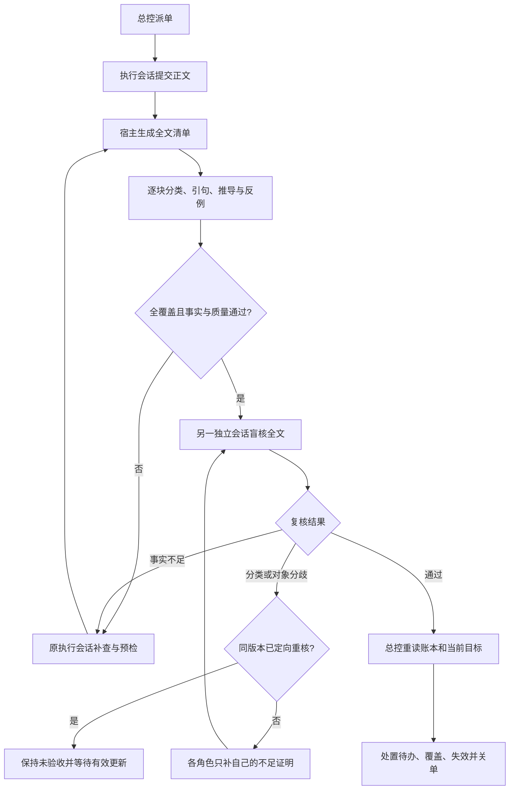

# 全文覆盖与逐条推导

0.7.3 在清单中标出宿主从原文识别的结构标签和有限阅读指令。它们仍须逐字覆盖，但不会进入事实并集。识别阅读指令须消费完整的有限句式并逐项确认裸概念。含新断言的修饰、条件、数量或未识别尾句保留核验义务。旧分类规则下已耗尽的争议可按当前规则重新核验。 行首 `[模拟]` 走来源范围证明，须有同一实际引用来源的已读声明或合成来源凭据，其后的命题仍分别核证。见[实测与回归](../experiments/results-0.7.3.md)。

0.7.2 将分类比较的句法边界与事实判断分开。宿主只按严格契约等价编号、格式和合法定位，错例后的解释与大白话的事实仍核。外部事实用原文及推导，明确的 `[摘录范围]` 和 `[稿件自述]` 分别用 `registered-excerpts` 或 `candidate` 对象检查。登记摘录的缺失仅限已登记范围，稿件自述用当前稿，不借外部标题证明。计数附明确行号清单时两者一并核对；逐行标记检查只受理明确的全称标记声明，不能拿引用路径充当标记、替数量或行号证明。组合句仍须逐项检查证据的覆盖范围。

同一版本只派一次定向重核。宿主保留各角色自己的已读范围和满足目标的证明，重核目标包括双方已识别的事实范围。缺证继续走实际退回；双方仍不一致时阻塞，不能使用旧待反证回执关单。维护者更新有效材料或明确要求后，按新版本重新核验。参见[真实分歧与验收](../experiments/results-0.7.2.md)。

上级是[核验与账本](verification.md)。实现见 [coverage.mjs](coverage.mjs)、[流程入口](index.mjs)；生产工具回归见 [coverage.test.mjs](../test/coverage.test.mjs)。真实模型的成功、失败和用量见 [0.6.0 实验](../experiments/results-0.6.0.md)与 [0.7.0 成本和共同误判实验](../experiments/results-0.7.0.md)。

## 两层门槛

程序负责核清单和证明契约，独立核验者负责判断含义。每个非空白字符都属于宿主生成的块，不由模型自行挑选“重要事实”。标题、表格、代码、脚注、括号及引用后面的句子全部保留。块是文本边界，不是假装已经解决了自然语言的原子命题识别；复合句仍须由核验者拆成连续的判断片段。

核验方先用 `prepare` 取得实际材料及覆盖入口，未返回的页须继续读取；也可用 `inventory` 分页取得清单。`record` 每次最多 12 块，每块 `parts` 逐字连续覆盖；单段可省 `quote`，多段必须给原文。不能漏块、跳过后半句或改写原句。正文摘要变化后旧清单失效，来源摘要变化后旧证明退回 pending；允许分批重新核验，单纯重新读文件不算重做判断。合法块保存，无效块明确返回并撤销对应旧判断，全部 pending 清完才允许提交。

`inventory` 默认每页 8 块。每个事实片段独立声明 `sourceRelation` 为原文支持、矛盾或不足；已判矛盾／不足就不能同时 `supported`。不能猜测作者有意在做实验或举反例，擅自把未标注的错误断言解释成正确示范。宿主识别到“因此、所以、由此、therefore”等明确推导连接词时，拒绝用 `direct` 跳过证明；这是保守的辅助识别，不宣称覆盖所有隐含推理。忠实翻译不要求候选与原文逐字相同，但证据引句本身必须逐字。

| 分类 | 需要什么 | 未达到时 |
|---|---|---|
| `direct` 直接转述 | 已授权、已实际读取的证据行，以及逐字出现的原文引句；判断是否支持整个片段 | `unsupported` 或 `uncertain`，给具体最小修正 |
| `inference` 推导 | 前提、关系规则、对象与条件、额外假设及其证据、反例检验 | 缺少字段或规则无效拒绝记录；可能有反例则不能支持 |
| `nonfactual` 非事实说明 | 具体说明为何该段不作事实主张，不能因其是标题就略过 | 独立反证重新分类；必核编号不能全部降为非事实 |
| `hypothesis` 明确假设 | 正文有 `[推测]`、`[假设]` 或 `[未证实]`，宿主固定状态为 `uncertain`，不同输入状态留痕 | 不能仅在回执里降级；不能用候选自证后续结论 |
| `error-example` 明确错例 | 原句以 `误读：`、`错例：`、`错误推理：` 或相应方括号标记开头；给所展示推理的反证或不足依据 | 没有标记不能猜成错例；状态固定为展示错误，不能成为已证事实或据此强迫作者改同义标签 |

每条推导的 `premises` 绑定实际原文。`source-warrant` 要用 `warrant` 指明原文中的桥接关系，不能写一句自己的结论冒充关系依据。`modus-ponens` 检查 P→Q、P 推出 Q；`equality-transitive` 检查 A=B、B=C 推出 A=C。概念标识必须一致，反向推理、换对象或缺符号不能通过结构检查。`configured-calculation` 绑定实际配置的计算及原始数据版本，数值转述不能冒充脚本计算。

作用范围可写具体短句，也可按 `objects` 和 `conditions` 分列。事实退回还必须给 `finding.kind/quote/fix`，其中矛盾退回提供原文反证；不能将排版、详细度或可选收尾建议伪装成未证事实。参数错误留给核验者纠正，必要的质量修订仍走既有质量验收。

正文明确写“原文为”“原句”或“逐字引文”，同时在该行给出授权文件和行号时，宿主另核引号中的文本是否逐字出现在那些来源行。只忽略空白布局，不把添写的分隔符、改写或拼接自动当作原话。不同就退回，改为实际引句或明确转述即可。其他引用格式和跨段脚注仍须核验者定位，不伪造它们的引用关系。

形式命题是否准确表达原文仍是语义问题。宿主不会因为模型把“完成”和“成功”都编码为 Q，就断言其含义相同。第二位核验者要重读原文、对象、关系与例外，检查前提成立而结论不成立的情况。

## 独立反证和退回

第一次核验通过只生成 `pending-audit`。另一个子会话从原文重新核验，读名单去掉全部核验回执，提示中不注入第一位的判断。该会话与执行方、第一核验方身份不同，同一工作单元的后续反证沿用该会话。这里是会话独立，不声称使用了不同模型或彼此错误必然独立。

所有块都有记录、未证事实为零、当前版本一致、脚本检查通过，且独立反证完成，才允许进入账本复盘。分类或证据对象分歧先返回核验方定向重核，仍无裁决时保留未验收。真正退回的编号外断言保存原句；只改标题、原句不动，补查提交会被拦住。改后的含义仍由核验重查，不把字符串发生变化当作事实变真。

总控的接受回执保留数量、摘要和结论，完整逐块证明留在宿主状态，不把整篇正文复制到中央回执。总控不能调用覆盖入口读取候选。退回回执保留必要的问题原句与修正要求。实验归档保留模型实际调用和详细证明，方便溯源。

## 范围和后续验证

受控文本文件仍限 256 KiB、单次读取最多 250 行；全文清单分页读取，不因页数而忽略尾部。宿主状态上限 8 MiB。超限会显式失败，需要拆成可验收单元，不会静默截断后通过。

这能强制“每处有记录、每条推导有依据、未完成复核不能关单”，不能保证任意自然语言被正确拆分和理解。两个同源模型仍可能同错；伪造网站的归属、缺失的原始研究、语境或领域前提也要另外查证。高影响事项应加入异构验证或专业人工核验。用正确样例衡量误退，用多类错误衡量漏放，不把一律拒绝视为高质量。

方法参考：[SAFE 官方实现](https://github.com/google-deepmind/long-form-factuality/tree/main/eval/safe) 将长答案事实逐项核验；[ALCE 官方项目](https://github.com/princeton-nlp/ALCE) 分别评价正确性和引用质量。本实现另外加入宿主全文字符覆盖、有限证明规则与独立反证状态门槛，没有直接移植二者代码，也不继承其研究结果。

大白话：先保证每句话都有人查，再要求“凭什么能这么推”写清楚，最后换一个独立会话再查一次；有出处、有表格、有通过标签，都不等于结论自动是真的。
