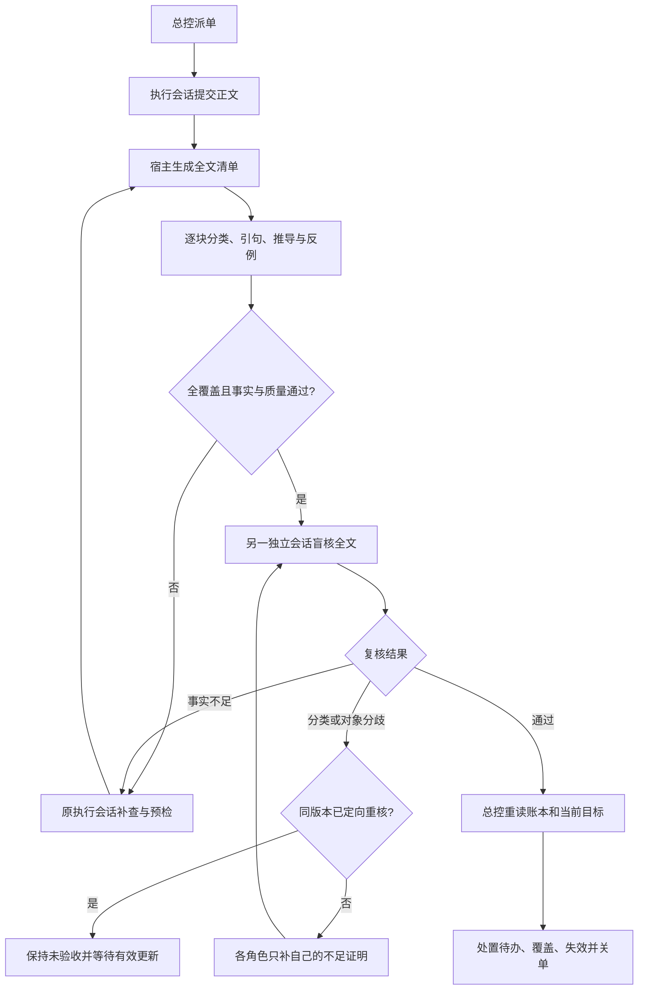

# 全文覆盖与逐条推导

## 宿主数值结果

清单里的 `hostMeasurement` 对应宿主生成的一条正文。首审与独立复核分别检查当前原始材料和稿件口径，用 `measurement` 填宿主提供的编号，并给各自的事实判断与依据。宿主用当期材料附上结果、实际参与计算的原文行和计算口径。稿件引用计数只统计正文中可识别的同行出处位置。

重复填写同一角色已核过的原始行时，完整一致的来源和引句可由宿主去重。冲突、额外行或改写仍须处理。两道审核独立证明了同一行中的完整逐字引句且原文位置和版本都相同时，固定引用引导词作为结构处理。引句外新增的事实和范围判断仍需核实。

0.7.3 在清单中标出宿主从原文识别的结构标签和有限阅读指令。它们仍须逐字覆盖，但不会进入事实并集。识别阅读指令须消费完整的有限句式并逐项确认裸概念。含新断言的修饰、条件、数量或未识别尾句保留核验义务。旧分类规则下已耗尽的争议可按当前规则重新核验。 行首 `[模拟]` 走来源范围证明，须有同一实际引用来源的已读声明或合成来源凭据，其后的命题仍分别核证。见[实测与回归](../experiments/results-0.7.3.md)。

0.7.2 将分类比较的句法边界与事实判断分开。宿主只按严格契约等价编号、格式和合法定位，错例后的解释与大白话的事实仍核。外部事实用原文及推导，明确的 `[摘录范围]` 和 `[稿件自述]` 分别用 `registered-excerpts` 或 `candidate` 对象检查。登记摘录的缺失仅限已登记范围，稿件自述用当前稿，不借外部标题证明。计数附明确行号清单时两者一并核对；逐行标记检查只受理明确的全称标记声明，不能拿引用路径充当标记、替数量或行号证明。组合句仍须逐项检查证据的覆盖范围。

同一版本只派一次定向重核。宿主保留各角色自己的已读范围和满足目标的证明，重核目标包括双方已识别的事实范围。缺证继续走实际退回；双方仍不一致时阻塞，不能使用旧待反证回执关单。维护者更新有效材料或明确要求后，按新版本重新核验。参见[真实分歧与验收](../experiments/results-0.7.2.md)。

上级是[核验与账本](verification.md)。实现见 [coverage.mjs](coverage.mjs)、[流程入口](index.mjs)；生产工具回归见 [coverage.test.mjs](../test/coverage.test.mjs)。真实模型的成功、失败和用量见 [0.6.0 实验](../experiments/results-0.6.0.md)与 [0.7.0 成本和共同误判实验](../experiments/results-0.7.0.md)。

0.7.4 将 `[稿件自述]` 和 `[摘录范围]` 的字面标签从事实比较中分开，标签后的内容继续走指定的证据对象。稿件说每条引用都在行首带某标记时，使用 `citations-leading-marked` 按实际行首复核，行中的标记出现次数不能代证。逐字引句后有明确、单一的相邻定位时，只核该定位。无明确归属的脚注和间接引语仍逐条做语义复核。

0.7.5 对同一行的两条组合自述分别举证。例如 `行号定位 N 行：带 <来源> 的行号定位为第 <清单> 行；同带 [模拟] M 行：第 <子集清单> 行。` 清单提示给每块单独的 `citation-profile` 调用。宿主从实际原句取两个数字和两份行号，在同一版本稿件中复算。补查预检和提交共用这套复算，识别到错误组合时留在原阶段并指出实测值。`同带` 按引用行中实际出现的字面标记查子集，明确写 `同行首带` 才按行首查。位置、数量、列表或语义附句有独立问题时，仍分别核验。

写完应先完整读回当前稿，再看 `citationProfileChecks` 的稿件摘要和逐项结果。0.7.6 在缺当前稿完整阅读记录时返回 `ok:false` 与 `pendingRead`，同时保留已完成的其他修补检查。提交与预检都以当前字节的完整读回为准。

候选准备结果和核验回执的 `candidatePositions` 由宿主按当前稿的明确标签生成，包含路径、SHA-256、去重后的物理错例行和推测行。标签说明作者如何呈现这句话。错例仍要给反证，推测仍保持未证，回执中的模型说明不得替代这些定位。

## 两层门槛

当前总纲明确声明「逐项结果：ID1、ID2」或「为 ID1、ID2 分别给出结论」时，`prepare.outcomeContract` 给出实际编号及条款行号。正文逐项写可定位的 `ID：结果` 字段，也可用表格对应列；要求大白话时，与正文使用同一明确结果。每个角色分别以 `original-fact` 证明这一项的原始记录，以 `project-application` 证明正文和总结的结果。引用某词、结果未定、缺结果和两处结果冲突分别处理。真实资料口径歧义须提交具体澄清问题，宿主等总纲更新再恢复，账本待这两份结果回执通过才可关单。无编号或未声明逐项结果的自由写作继续按常规质量和证据验收。

两道审核可在 `coverage status` 看本会话的 `outcomeProofGaps`。它按事项、正文或大白话位置、应有的断言类型和当前覆盖块列出尚未满足的证明。原始记录和处置所引的同一记录也会在这里核对。已经正确的处置回执可以原样提交，缺的就是证明时只需回相应覆盖块补证。仅转述总纲时，`prepare.contract.projectPolicy.partsExample` 给出与工具一致的嵌套结构，`premises:[]` 和 `assumptions:[]` 均在 `inference` 内。逐字条款、适用范围以及模型自己的判断仍要填写。

合在一块的断言仍按意思逐条用 `parts[].assertion` 提交。资料身份（`material-identity`）核真实且已读的登记材料；原始事实（`original-fact`）核具体原文；项目规则（`project-rule`）单引当前总纲；项目处置（`project-application`）同时引用当前总纲和实际记录。稿件归属（`manuscript-attribution`）只证明所选 Markdown 小节内可见编号断言实际指向哪份材料，须给完整编号行区间和实际已读出处，不能替整篇普通正文背书。

定向重核的 `requiredAssertions` 绑定实际片段和所需证据种类。证明充足的原角色可保留自己的记录；两边都有同类证明却用了不同规则、记录或出处时，要求双方核对实际来源。真实缺证保留具体 finding；双方都改成非事实或都绕回无总纲的直述，不能解除原有义务。资料身份相同不等于内容真实性相同；宿主核结构与来源，仍由两道独立审核判断逐字原文是否支持结论。

程序负责核清单和证明契约，独立核验者负责判断含义。每个非空白字符都属于宿主生成的块，不由模型自行挑选“重要事实”。标题、表格、代码、脚注、括号及引用后面的句子全部保留。块是文本边界，不是假装已经解决了自然语言的原子命题识别；复合句仍须由核验者拆成连续的判断片段。

核验方先用 `prepare` 取得实际材料及覆盖入口，未返回的页须继续读取；也可用 `inventory` 分页取得清单。`record` 每次最多 12 块，每块 `parts` 逐字连续覆盖；单段可省 `quote`，多段必须给原文。不能漏块、跳过后半句或改写原句。正文摘要变化后旧清单失效，来源摘要变化后旧证明退回 pending；允许分批重新核验，单纯重新读文件不算重做判断。合法块保存，无效块明确返回并撤销对应旧判断，全部 pending 清完才允许提交。

`inventory` 默认每页 8 块。每个事实片段独立声明 `sourceRelation` 为原文支持、矛盾或不足；已判矛盾／不足就不能同时 `supported`。不能猜测作者有意在做实验或举反例，擅自把未标注的错误断言解释成正确示范。宿主识别到“因此、所以、由此、therefore”等明确推导连接词时，拒绝用 `direct` 跳过证明；这是保守的辅助识别，不宣称覆盖所有隐含推理。忠实翻译不要求候选与原文逐字相同，但证据引句本身必须逐字。

| 分类 | 需要什么 | 未达到时 |
|---|---|---|
| `direct` 直接转述 | 已授权、已实际读取的证据行，以及逐字出现的原文引句；判断是否支持整个片段 | `unsupported` 或 `uncertain`，给具体最小修正 |
| `inference` 推导 | 前提、关系规则、对象与条件、额外假设及其证据、反例检验 | 缺少字段或规则无效拒绝记录；可能有反例则不能支持 |
| `nonfactual` 非事实说明 | 具体说明为何该段不作事实主张，不能因其是标题就略过 | 独立反证重新分类；必核编号不能全部降为非事实 |
| `hypothesis` 明确假设 | 正文有 `[推测]`、`[假设]` 或 `[未证实]`，宿主固定状态为 `uncertain`，不同输入状态留痕 | 不能仅在回执里降级；不能用候选自证后续结论 |
| `error-example` 明确错例 | 原句以 `误读：`、`错例：`、`错误推理：` 或相应方括号标记开头；给所展示推理的反证或不足依据 | 没有标记不能猜成错例；状态固定为展示错误，不能成为已证事实或据此强迫作者改同义标签 |

每条推导的 `premises` 绑定实际原文。`source-warrant` 要用 `warrant` 指明原文中的桥接关系，不能写一句自己的结论冒充关系依据。`modus-ponens` 检查 P→Q、P 推出 Q；`equality-transitive` 检查 A=B、B=C 推出 A=C。概念标识必须一致，反向推理、换对象或缺符号不能通过结构检查。`configured-calculation` 绑定实际配置的计算及原始数据版本，数值转述不能冒充脚本计算。

`bounded-non-entailment` 覆盖一种明确限定在本例的单向分类规则。清单的 `inferenceHint` 指定实际结论片段与相邻来源范围，核验者仍需分别读原文并给出判断依据。宿主匹配规则、样本、分类与复核动作，在给定前提下检验其他对象可以属于或不属于该分类。两种假设都成立时，前提不足以推出其他对象属于该分类，也不足以证明它们全都不属于。复杂关系、额外前提和其他措辞照常逐项核验。

作用范围可写具体短句，也可按 `objects` 和 `conditions` 分列。事实退回还必须给 `finding.kind/quote/fix`，其中矛盾退回提供原文反证；不能将排版、详细度或可选收尾建议伪装成未证事实。参数错误留给核验者纠正，必要的质量修订仍走既有质量验收。

正文明确写“原文为”“原句”或“逐字引文”，同时在该行给出授权文件和行号时，宿主另核引号中的文本是否逐字出现在那些来源行。只忽略空白布局，不把添写的分隔符、改写或拼接自动当作原话。不同就退回，改为实际引句或明确转述即可。其他引用格式和跨段脚注仍须核验者定位，不伪造它们的引用关系。

明确逐字引句紧接 `[^id]` 时，宿主可绑定当前稿的唯一脚注定义。定义必须只有一个清楚的授权文件和行号，引句只核该范围。相同标记多处引用、重复定义、混合出处或无有效定义时，按缺证处理，旁边的引文不能代证。代码和转义标记不作为真实脚注。补查既可撤回错引，也可修复定义并实际读回当前原文。独立核验仍须逐项判断定义或正文中的其他事实。

行内错引的修复指纹包含原引句及其精确相邻定位。正文另处保留同一段文字时，以其实际归属判断，正确脚注不会继承旧错引的退回项。核验方对同一物理归属中的较短片段另行记录时，只有能唯一定位到该错引的重叠记录会沿用这一修复范围。同一行的其他断言继续各自核验。

两份当前逐字证明都已确认同一相邻脚注、定义和实际来源时，标记字符不会单独造成分类分歧。引句、定义和其他断言仍参与全文核对。缺证、错引或归属不一致时沿用原分歧门槛。

明确位于段首的 `[补充]` 是版式标签，宿主只标出标签本身。行中提及同样的字样，以及标签后的数字、原文或推导，都按实际事实片段继续核对。

可见原句和末尾大白话检查把引用后的顶层 ATX 标题或合法围栏作为新块，即使它们紧接引用而没有空行。没有明确新块边界的普通引用续行仍按引用处理。

行首 `[模拟]` 的归属优先找带标记的陈述块内唯一来源。若标点把出处留在同一物理行的另一块中，只保留整行确有唯一可定位来源的情形。两个不同出处都留在后段、而标记所在陈述没有可定位出处时，补查预检提示在对应块内写明出处或分行，直接提交也拦截。合成类型与所称事实仍要由核验方查实际原文。

明确写出“在第 N 行列出 X 与 Y”并给出唯一相邻出处时，宿主在实际已读的所称行内检查两个字面值，较宽的引注不能把后续行并入判断。宿主能确定缺失时会生成精确退回，保留核验者自己的原判断。成员存在或表述超出有限句式时，仍由独立核验判断整条断言的含义和范围。

形式命题是否准确表达原文仍是语义问题。宿主不会因为模型把“完成”和“成功”都编码为 Q，就断言其含义相同。第二位核验者要重读原文、对象、关系与例外，检查前提成立而结论不成立的情况。

## 独立反证和退回

第一次核验通过只生成 `pending-audit`。另一个子会话从原文重新核验，读名单去掉全部核验回执，提示中不注入第一位的判断。该会话与执行方、第一核验方身份不同，同一工作单元的后续反证沿用该会话。这里是会话独立，不声称使用了不同模型或彼此错误必然独立。

所有块都有记录、未证事实为零、当前版本一致、脚本检查通过，且独立反证完成，才允许进入账本复盘。分类或证据对象分歧先返回核验方定向重核，仍无裁决时保留未验收。真正退回的编号外断言保存原句；只改标题、原句不动，补查提交会被拦住。改后的含义仍由核验重查，不把字符串发生变化当作事实变真。

总控的接受回执保留数量、摘要和结论，完整逐块证明留在宿主状态，不把整篇正文复制到中央回执。总控不能调用覆盖入口读取候选。退回回执保留必要的问题原句与修正要求。实验归档保留模型实际调用和详细证明，方便溯源。

## 范围和后续验证

受控文本文件仍限 256 KiB、单次读取最多 250 行；全文清单分页读取，不因页数而忽略尾部。宿主状态上限 8 MiB。超限会显式失败，需要拆成可验收单元，不会静默截断后通过。

这能强制“每处有记录、每条推导有依据、未完成复核不能关单”，不能保证任意自然语言被正确拆分和理解。两个同源模型仍可能同错；伪造网站的归属、缺失的原始研究、语境或领域前提也要另外查证。高影响事项应加入异构验证或专业人工核验。用正确样例衡量误退，用多类错误衡量漏放，不把一律拒绝视为高质量。

方法参考：[SAFE 官方实现](https://github.com/google-deepmind/long-form-factuality/tree/main/eval/safe) 将长答案事实逐项核验；[ALCE 官方项目](https://github.com/princeton-nlp/ALCE) 分别评价正确性和引用质量。本实现另外加入宿主全文字符覆盖、有限证明规则与独立反证状态门槛，没有直接移植二者代码，也不继承其研究结果。

大白话：先保证每句话都有人查，再要求“凭什么能这么推”写清楚，最后换一个独立会话再查一次；有出处、有表格、有通过标签，都不等于结论自动是真的。
